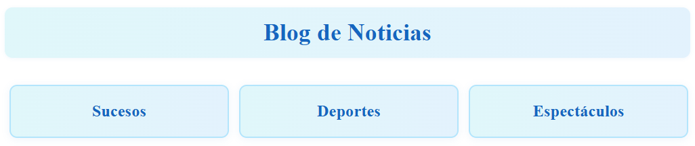

# Blog de Noticias con Nuxt.js

Este proyecto es un blog dinámico desarrollado con Nuxt.js y @nuxt/content, estructurado en tres categorías: sucesos, deportes y espectáculos. Cada noticia incluye autor, fecha, imagen y contenido extenso.

## Estructura

- `/content/sucesos/`: Noticias de sucesos
- `/content/deportes/`: Noticias de deportes
- `/content/espectaculos/`: Noticias de espectáculos

## Funcionalidades

- Navegación entre categorías desde la página principal
- Avance y retroceso entre noticias
- Generación estática lista para Netlify

## Despliegue en Netlify

1. Inicia sesión en Netlify y crea un nuevo sitio desde GitHub.
2. Selecciona el repositorio `blog_nuxt`.
3. Build command: `npm run generate`
4. Publish directory: `.output/public`
5. Haz clic en "Deploy site".

## Enlace al sitio publicado

## Vista del menú principal

---
